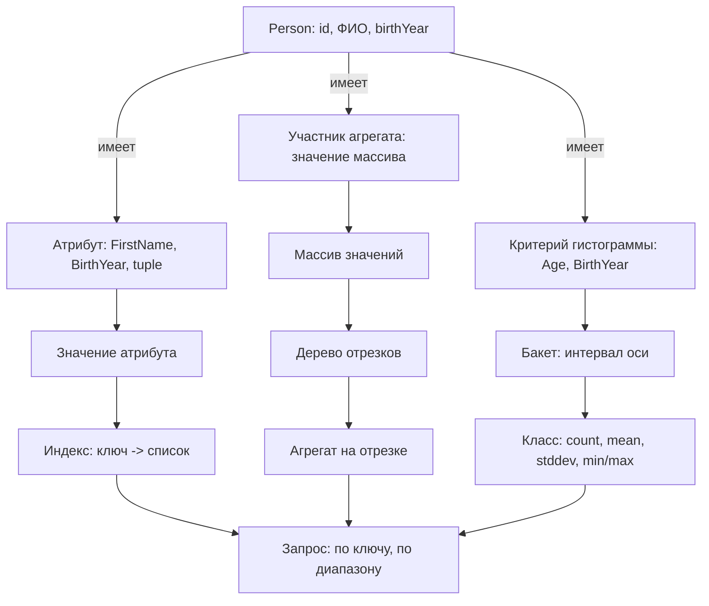
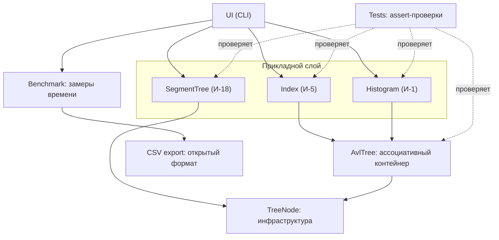

# Дизайн проекта: Сравнение алгоритмов поиска

> **Проект:** лабораторная работа №2 по курсу «Информатика (организация и поиск данных)»  
> **Вариант:** И-5 + И-5.1 + И-5.2 + И-1 + И-1.1 + И-1.3 + И-18  
> **Суммарный рейтинг:** 56  
> **Стандарт:** C++17

---

## 1. Постановка задачи

### 1.1. Что делается в работе

Разрабатывается программа на C++, которая демонстрирует и сравнивает различные **структуры организации и поиска информации** на трёх прикладных задачах.

| Код | Задача | Рейтинг |
|---|---|---:|
| **И-5** | Индексирование данных | 7 |
| **И-5.1** | Поддержка поиска по диапазону значений | 5 |
| **И-5.2** | Поддержка индексирования составных атрибутов | 7 |
| **И-1** | Построение гистограммы распределения объектов по группам | 10 |
| **И-1.1** | Реализация обработки в стиле map-reduce | 5 |
| **И-1.3** | Базовый+ уровень реализации (параметризация критерия) | 10 |
| **И-18** | Дерево отрезков и интервальные операции | 12 |
| | **Итого** | **56** |

Все три задачи опираются на **одну и ту же идею**: заменить линейный просмотр коллекции ассоциативной структурой (деревом поиска или агрегатным деревом), чтобы снизить асимптотику типичных операций с `O(n)` до `O(log n)`.

Для каждой задачи в программе сосуществуют:

- **наивный** вариант (линейный проход по коллекции);
- **структурный** вариант (индекс или дерево).

Оба запускаются на одних и тех же данных, время замеряется, результаты выгружаются в открытый формат CSV для построения графиков.

### 1.2. Зачем это может быть нужно

**Общий класс задач** — быстрый поиск и агрегация в больших коллекциях, которые **редко меняются**, но по которым **часто выполняются запросы**.

| Область | Пример |
|---|---|
| Справочники | «Найти всех Иваноых 1990 года рождения», «выбрать всех в диапазоне лет» |
| Аналитика | Распределение клиентов по возрасту / сумме покупок со статистикой по группам |
| Технические приложения | Суммы, минимумы, максимумы на отрезках массива с частыми обновлениями |

Во всех случаях **правильный выбор структуры** меняет асимптотику и делает задачу практически решаемой на больших объёмах. 

---

## 2. Сущности прикладной задачи

### 2.1. Сущности с описанием

| Сущность | Описание |
|---|---|
| **Person** | Единица данных. Набор атрибутов фиксирован: `id`, `FirstName`, `MiddleName`, `LastName`, `BirthYear`. Имеет производные атрибуты: полное ФИО, ФИО в формате «Фамилия И.О.», возраст на заданный год. После создания — **read-only**. |
| **Атрибут** | Отображение `Person -> значение` (например, `FirstName`, `BirthYear`, `tuple(FirstName, LastName, BirthYear)`). |
| **Значение атрибута** | Конкретное значение: строка, число или кортеж. |
| **Индекс** | Отображение «значение атрибута -> множество Person», у которых атрибут принимает такое значение. |
| **Составной индекс** | Индекс, у которого ключом является кортеж значений нескольких атрибутов. |
| **Критерий гистограммы** | Отображение `Person -> вещественное число`, по которому строится распределение. |
| **Бакет** | Один элемент разбиения диапазона оси на равные отрезки. |
| **Класс (Bucket)** | Статистическое описание бакета: размер, среднее, дисперсия, минимум, максимум. |
| **Агрегат** | Свёрнутое значение по отрезку массива (сумма, min, max и т. п.). |
| **Запрос** | Операция выборки по индексу или агрегатный запрос на отрезке. |

### 2.2. Связи между сущностями

**Чтение связей:**

- `Person` — центральная сущность; через неё определяются атрибуты, критерий и участие в агрегате.
- Индекс — «ключ -> значения», обслуживает запросы по ключу и по диапазону.
- Бакет — интервал оси, содержит статистическое описание (класс).
- Дерево отрезков — над массивом значений, отвечает за агрегаты.
- Запрос — общая точка, куда приходят все три ветки.

---

## 3. Архитектура

### 3.1. Высокоуровневые компоненты

| # | Компонент | Назначение |
|---|---|---|
| 1 | **UI (консольное меню)** | Выбор задачи, режима (демо/бенчмарк), ввод или генерация данных, запуск, просмотр, экспорт |
| 2 | **Прикладной слой И-5** | Сущность `Person` + модуль индексирования |
| 3 | **Прикладной слой И-1** | Модуль построения распределения и накопления статистики |
| 4 | **Прикладной слой И-18** | Модуль интервальных операций и обновления точки |
| 5 | **AVL-дерево** | Ассоциативный контейнер общего вида «ключ -> значение» |
| 6 | **Дерево отрезков** | Агрегатное дерево над массивом, шаблон по типу и операции слияния |
| 7 | **Инфраструктура узла дерева** | Общий узел, переиспользуемый обоими деревьями |
| 8 | **Слой замеров и экспорта** | Обёртка замеров и сохранение результатов в открытый формат |
| 9 | **Слой тестирования** | Assert-тесты корректности для всех модулей и базовых структур |

### 3.2. Связи между компонентами

### 3.3. Описание компонентов, алгоритмов и решений

#### Узел дерева (инфраструктура)

Единая узловая структура, унаследованная из предыдущей лабораторной работы. Содержит данные, левый и правый указатели, операции клонирования, разрушения и обхода.

#### AVL-дерево (ассоциативный контейнер)

**Решения:**

- *Строится поверх существующего узла*, а не с нуля. Высота поддерева хранится в самом значении (обёртка «ключ + значение + высота»), чтобы не менять узел.
- *Компаратор — параметр шаблона.* Позволяет использовать один контейнер для строк, чисел и кортежей, что критично для составных индексов.
- *Две семантики вставки*: «map» (ключ уникален, значение перезаписывается) и «multimap» (несколько записей под одним ключом складываются в контейнер). Вторая нужна индексам: у одного `FirstName` много `Person`.
- *Диапазонный запрос* реализован через **отсечение поддеревьев**: если узел целиком вне диапазона, соответствующее поддерево не обходится. Это даёт `O(log n + k)`, а не `O(n)`.
- *Балансировка AVL* выбрана как компромисс: строже, чем красно-чёрное, но проще в реализации, высота гарантированно логарифмическая.

| Операция | Сложность |
|---|---|
| Вставка / удаление / поиск | `O(log n)` |
| Диапазонный запрос | `O(log n + k)` |
| In-order обход | `O(n)` |
| Высота дерева | `O(log n)` |

#### Модуль И-5 (Индексирование)

**Решения:**

- Сущность `Person` — **неизменяемая** после создания; никаких сеттеров. Иначе индексы, построенные по значениям атрибутов, устаревали бы при изменении. Данные read-only.
- Коллекция `Person` хранится **внутри** модуля индексирования (копия пользовательской). Индексы хранят указатели на её элементы, поэтому время жизни коллекции и индексов совпадает — защита от висячих указателей.
- Исходная коллекция **не сортируется** — прямое требование ТЗ; индексы «живут сбоку».
- Поддерживаются **одиночные** и **составные** индексы; последние реализуются через ключ-кортеж и стандартный лексикографический порядок, без специального компаратора.
- Диапазонный запрос — `O(log n + k)` за счёт отсечения поддеревьев.
- Повторное построение полностью сбрасывает старые индексы — иначе остались бы указатели на уже удалённые объекты.

#### Модуль И-1 (Гистограмма)

**Решения:**

- Параметры — диапазон, число бакетов и **функция-критерий**. Параметризация критерия — это то, что делает гистограмму универсальной и соответствует «базовому+» уровню из ТЗ.
- Каждый бакет хранит не только счётчик, но и **статистическое описание класса**: сумму, сумму квадратов, минимум, максимум. Это «продвинутый» уровень из ТЗ.
- Статистика считается **онлайн**, без хранения всех значений: среднее = сумма / счётчик, дисперсия через сумму квадратов. Память — `O(число бакетов)`, а не `O(размер коллекции)`.
- **Обработка в стиле map-reduce** реализована как явные этапы: MAP (для каждого элемента — номер бакета) и REDUCE (свёртка пар по ключу в агрегаты). Агрегаты коммутативны и ассоциативны, есть **операция слияния двух бакетов** — это позволяет:
  - сравнивать результат map-reduce с последовательным построением (тесты);
  - параллелить reduce в будущем (архитектурный задел).
- Значения вне диапазона игнорируются (по ТЗ диапазон задаётся извне); значения ровно на правой границе попадают в последний бакет (клампинг индекса).

#### Модуль И-18 (Дерево отрезков)

**Решения:**

- Шаблон по **типу агрегата** и **операции слияния**. Нейтральный элемент передаётся извне. Это даёт одну реализацию для суммы, минимума, максимума, произведения и т. п. — без дублирования кода.
- Узел — тот же переиспользуемый `TreeNode`. **Границы отрезка** не хранятся в узле, а передаются через параметры рекурсии — меньше памяти, не нужно расширять узел, значения полей не «двоятся».
- Интервальный запрос использует **три классических случая**: «вне запроса -> нейтрал», «полностью в запросе -> готовый агрегат», «частичное пересечение -> рекурсия в оба ребёнка и слияние». Это и даёт `O(log n)`.
- Обновление точки — спуск по одному пути с пересчётом агрегатов на обратном ходе, `O(log n)`.

| Операция | Сложность |
|---|---|
| Построение | `O(n)` |
| Запрос на отрезке | `O(log n)` |
| Обновление точки | `O(log n)` |
| Память | `O(n)` |

#### UI-компонент (консольное меню)

**Решения:**

- Каждая задача доступна в двух режимах:
  - **«демо»** — малые данные, ручной ввод или случайная генерация, просмотр исходных данных и результата рядом;
  - **«бенчмарк»** — большие данные, сравнение структурного алгоритма с наивным.
- Разделение демо и бенчмарка принципиально: в демо важна наблюдаемость и ручная проверка, в бенчмарке — воспроизводимость и замеры.
- Результаты сохраняются в **CSV** (открытый формат, разделитель `;` — совместимость с русской локалью Excel). По этому CSV затем строятся графики зависимости времени от `n`, визуально показывающие разницу `O(n)` vs `O(log n)`.

#### Слой тестирования

Assert-тесты покрывают:

- корректность балансировки AVL (высота остаётся `O(log n)` на больших `n`);
- корректность диапазонного поиска vs фильтрация;
- корректность составных индексов vs линейный поиск;
- совпадение `Histogram::build` и `Histogram::mapReduce`;
- корректность дерева отрезков vs наивный подсчёт суммы;
- инварианты (сумма счётчиков по бакетам = размер коллекции и т. п.).

---

## 4. Функциональные требования

### 4.1. К сущности Person

- [x] Хранить фиксированный набор атрибутов: идентификатор, ФИО по частям, год рождения.
- [x] Вычислять производные атрибуты: полное ФИО, ФИО в формате «Фамилия И.О.», возраст на заданный год.
- [x] Быть **read-only** после создания (никаких сеттеров).
- [x] Иметь конструктор по умолчанию (для совместимости с контейнерами и узлами дерева).
- [x] Иметь форматированный вывод (для меню, логов и отладки).

### 4.2. К модулю индексирования (И-5)

- [x] Построить индексы по **одиночным** атрибутам (например, `FirstName`, `BirthYear`).
- [x] Построить индексы по **составным** атрибутам (например, `(FirstName, LastName, BirthYear)` и `(FullName, Age(2019))`).
- [x] Обеспечить поиск по точному значению одиночного атрибута за `O(log n + k)`.
- [x] Обеспечить поиск по точному значению составного атрибута за `O(log n + k)`.
- [x] Обеспечить **поиск по диапазону** значений за `O(log n + k)`.
- [x] Не сортировать исходную коллекцию и сохранять её порядок.
- [x] Повторный вызов построения — полностью пересобирает индексы.
- [x] Иметь средства просмотра исходных данных и результата поиска рядом (для ручной проверки).

### 4.3. К модулю гистограммы (И-1)

- [x] Задавать диапазон, число бакетов и **критерий-функцию** построения.
- [x] Строить распределение коллекции по критерию.
- [x] Хранить по каждому бакету **статистическое описание**: количество, среднее, дисперсия / стандартное отклонение, минимум, максимум.
- [x] Строить ту же гистограмму **в стиле map-reduce** с двумя явными этапами (MAP + REDUCE) и с возможностью слияния частичных результатов.
- [x] Сбрасывать предыдущее состояние при повторном построении.
- [x] Игнорировать значения вне диапазона.
- [x] Клампить значения ровно на правой границе в последний бакет.
- [x] Показывать распределение и статистику по каждому бакету.

### 4.4. К модулю дерева отрезков (И-18)

- [x] Строить дерево по входному массиву.
- [x] Поддерживать **интервальный запрос** агрегата с произвольной операцией слияния.
- [x] Поддерживать **обновление одного элемента** (point update).
- [x] Обеспечивать `O(log n)` на запрос и на обновление.
- [x] Обнаруживать выход за границы массива (ошибка — через исключение).
- [x] Работать с нетривиальными типами агрегатов (кортежи, структуры с операцией слияния).

### 4.5. К системе в целом

- [x] Выбор задачи через UI.
- [x] Генерация случайных данных для бенчмарка и **ручной ввод** для малых сценариев.
- [x] Просмотр исходных данных и результата для ручной проверки.
- [x] **Замер времени** выполнения алгоритма (в миллисекундах).
- [x] **Сравнение** структурного алгоритма с наивным на одних и тех же данных.
- [x] **Экспорт** результатов в CSV (открытый формат, пригодный для Excel/gnuplot).
- [x] Корректность ключевых алгоритмов подтверждена **тестами**.
- [x] Сборка под C++17 (используются `std::optional`, structured bindings).

### 4.6. Особые сценарии

| Ситуация | Поведение |
|---|---|
| Повторное построение индексов / гистограммы | Старые данные полностью сбрасываются (защита от висячих указателей и неконсистентности) |
| Пустая коллекция | Построение проходит без ошибок; поиски дают пустой результат; гистограмма пуста; сумма по бакетам = 0 |
| Значения вне диапазона гистограммы | Игнорируются |
| Значение на правой границе гистограммы | Попадает в последний бакет |
| Некорректные параметры гистограммы (`bucketsCount <= 0`, `hi <= lo`) | Исключение `invalid_argument` |
| Выход за границы дерева отрезков | Исключение `out_of_range` |
| Отсутствие ключа в индексе | Пустой результат, без исключения |
| Несколько `main`-файлов в сборке | UI и тесты — разные точки входа; конфигурация сборки согласована, конфликта символов нет |

---

## Приложение А. Соответствие заданию

| Требование ЛР-2 | Где выполнено |
|---|---|
| Выбрать задачу (одну или несколько) из раздела 2 | И-5 + И-1 + И-18 |
| Суммарный рейтинг >= 55 | 56 |
| Решение с помощью методов из раздела 3 | Ассоциативная память (AVL), дерево отрезков |
| Покрыть ключевые алгоритмы тестами | `lab2/tests.cpp` |
| Выбор любого алгоритма и запуск на произвольных данных | Меню `lab2/main.cpp` |
| Автоматическая и ручная проверка корректности | Тесты + демо-режим с просмотром |
| Просмотр исходных данных и результата | Демо-режим |
| Пользовательский интерфейс (консольный) | Меню |
| Функция измерения времени | `lab2/Benchmark.h` |
| Функция сравнения алгоритмов на одних данных | `benchIndex`, `benchSegment` в `main.cpp` |
| Экспорт данных в открытом формате | `lab2/Csv.h`, `benchmark.csv` |
| Краткое ТЗ | Этот документ |