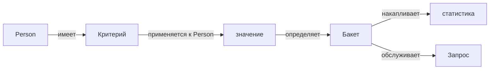
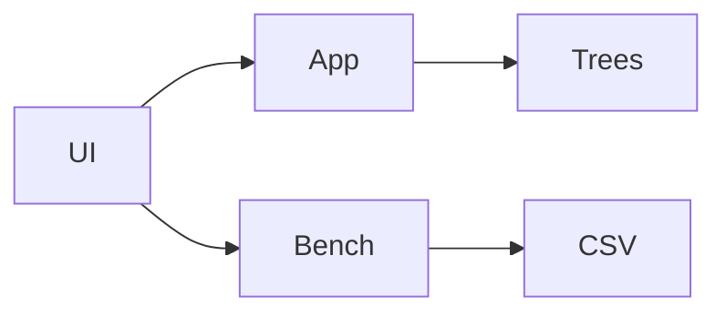

# Дизайн проекта: Сравнение алгоритмов поиска

> **Проект:** лабораторная работа №2 по курсу «Информатика (организация и поиск данных)»  
> **Суммарный рейтинг:** 56  
> **Стандарт:** C++17

| Код | Задача | Рейтинг |
|---|---|---:|
| И-5 | Индексирование данных | 7 |
| И-5.1 | Поддержка поиска по диапазону значений | 5 |
| И-5.2 | Поддержка индексирования составных атрибутов | 7 |
| И-1 | Построение гистограммы | 10 |
| И-1.1 | Обработка в стиле map-reduce | 5 |
| И-1.3 | Параметризация критерия | 10 |
| И-18 | Дерево отрезков и интервальные операции | 12 |
| | **Итого** | **56** |

---

## 1. Постановка задачи

### 1.1. Что делается в работе

Разрабатывается программа на C++, которая демонстрирует и сравнивает **структуры организации и поиска информации** на трёх прикладных задачах: индексирование коллекции объектов, построение распределения по критерию и агрегатные запросы на отрезках массива.

Все три задачи опираются на одну идею: заменить линейный просмотр коллекции ассоциативной структурой, чтобы снизить асимптотику типичных операций с `O(n)` до `O(log n)`.

Для каждой задачи в программе сосуществуют:

- **наивный** вариант (линейный проход по коллекции);
- **структурный** вариант (индекс или дерево).

Оба запускаются на одних и тех же данных, время замеряется, результаты выгружаются в CSV для построения графиков.

### 1.2. Зачем это может быть нужно

**Общий класс задач** — быстрый поиск и агрегация в больших коллекциях, которые **редко меняются**, но по которым **часто выполняются запросы**.

| Область | Пример |
|---|---|
| Справочники | «Найти всех Ивановых 1990 года рождения», «выбрать всех в диапазоне лет» |
| Аналитика | Распределение клиентов по возрасту / сумме покупок со статистикой по группам |
| Технические приложения | Суммы, минимумы, максимумы на отрезках массива с частыми обновлениями |

Во всех случаях **правильный выбор структуры** меняет асимптотику и делает задачу практически решаемой на больших объёмах. Программа показывает выигрыш измеримо — сравнением времени на одних данных.

---

## 2. Сущности прикладной задачи

### 2.1. Общие понятия

Все три задачи работают с **коллекцией объектов** и **характеристиками** этих объектов. Зафиксируем общий словарь, чтобы не плодить лишние сущности:

| Понятие | Что это | Пример |
|---|---|---|
| **Объект** | Единица данных, с которой работает задача | `Person` |
| **Характеристика** | Именованное свойство объекта, которое можно вычислить | `FirstName`, `BirthYear`, `Age(2024)` |
| **Значение характеристики** | Результат применения характеристики к конкретному объекту | `"Ivan"`, `1990`, `34` |

**Значение — это не сущность, а результат.** Сущность — это характеристика (у неё есть имя и правило вычисления). Значение — то, что получается, когда правило применили к объекту.

Дальше в каждой задаче характеристики используются по-разному:

- в **индексировании** характеристика становится **ключом индекса**;
- в **гистограмме** характеристика становится **критерием распределения**;
- в **дереве отрезков** объектами являются элементы массива, а характеристикой — **агрегат** по отрезку.

### 2.2. Индексирование коллекции

**Что делает задача.** По коллекции объектов строятся «указатели» (индексы) «значение характеристики → множество объектов». После этого поиск по характеристике — это обращение к индексу, а не перебор всей коллекции.

| Сущность | Что это | Пример | Пояснение |
|---|---|---|---|
| **Person** | Единица данных с фиксированным набором характеристик | `{id: 42, FirstName: "Ivan", MiddleName: "X", LastName: "Ivanov", BirthYear: 1990}` | После создания не меняется. Характеристики read-only. |
| **Атрибут** | Именованное свойство `Person`, которое можно вычислить | `FirstName`, `BirthYear`, `(FirstName, LastName, BirthYear)` | Бывает **одиночным** (одно значение) и **составным** (кортеж из нескольких характеристик). |
| **Индекс** | Отображение «значение атрибута → множество `Person`» | `"Ivan" → [Person#42, Person#108, ...]` | Мультизначный: у одного значения может быть много объектов. Индекс строится по одной конкретной характеристике (или по одному составному ключу). |
| **Запрос** | Обращение к индексу | `findByFirstName("Ivan")`, `findByBirthYearRange(1990, 2000)`, `findByFirstLastYear("Ivan", "Ivanov", 1990)` | Три вида: по точному значению, по диапазону, по составному ключу. |

**Связи:**

### 2.3. Гистограмма

**Что делает задача.** Коллекция объектов распределяется по интервалам числовой оси. Для каждого интервала накапливается статистика (сколько объектов попало, какое среднее, разброс, минимум, максимум).

| Сущность | Что это | Пример | Пояснение |
|---|---|---|---|
| **Person** | Та же единица данных, что и в индексировании | — | Источник значений критерия. |
| **Критерий** | Числовая характеристика `Person`, по которой строится распределение | `Age(2024)`, `BirthYear`, длина фамилии | Параметризуется при создании гистограммы: одна и та же гистограмма может строиться по разным критериям. |
| **Бакет** | Один интервал оси. Содержит **и границы интервала, и накопленную статистику** | `[18, 28.33)`: `count=150, sum=3300, sumSq=74000, min=18, max=28` | — |
| **Запрос** | Обращение к бакету | `bucketAt(25)`, `all()` | Два вида: по значению (найти бакет, в который попадает значение) и «все бакеты по порядку номеров». |

**Связи:**

### 2.4. Дерево отрезков

**Что делает задача.** По массиву значений строятся агрегаты на отрезках. После этого запрос «агрегат на `[l, r]`» и обновление одного элемента выполняются за `O(log n)`.

| Сущность | Что это | Пример | Пояснение |
|---|---|---|---|
| **Массив** | Упорядоченная последовательность значений | `[5, 3, 8, 1, 9, ...]` | Источник данных. |
| **Агрегат** | Свёрнутое значение по отрезку массива | `sum(2..5) = 18`, `min(0..3) = 1` | Тип агрегата и операция слияния задаются при создании дерева. |
| **Запрос** | Обращение к агрегату или обновление элемента | `query(2, 5)`, `update(4, 50)` | Два вида: запрос агрегата на отрезке и обновление одного элемента. |

**Связи:**

### 2.5. Сводка

| Задача | Объект | Характеристика | Хранилище | Запрос |
|---|---|---|---|---|
| Индексирование | `Person` | Атрибут (одиночный или составной) | Индекс | По ключу, по диапазону, по составному ключу |
| Гистограмма | `Person` | Критерий (числовой) | Бакет со статистикой | По значению, все бакеты |
| Дерево отрезков | Массив значений | Агрегат (свёртка) | Узел дерева (агрегат по отрезку) | Агрегат на отрезке, обновление точки |

---

## 3. Архитектура

### 3.1. Высокоуровневые компоненты

| # | Компонент | Назначение |
|---|---|---|
| 1 | **UI (консольное меню)** | Выбор задачи и режима, ввод или генерация данных, запуск, просмотр, экспорт |
| 2 | **Прикладной слой** | Три модуля, по одному на задачу: индексирование, гистограмма, дерево отрезков |
| 3 | **Деревья (общая инфраструктура)** | Единый узел и две реализации над ним: AVL-дерево и дерево отрезков. Оба используют один и тот же `TreeNode` |
| 4 | **Слой замеров и экспорта** | Обёртка замеров времени и сохранение результатов в CSV |

### 3.2. Связи между компонентами

Все стрелки означают одно и то же — **«вызывает / использует»**.

Расшифровка:

- `UI` вызывает `App` (прикладные модули) и `Bench` (замеры).
- `App` использует `Trees` (AVL и дерево отрезков).
- `Bench` сохраняет результаты через `CSV`.

### 3.3. Принятые решения

Здесь только то, что было **выбрано** в ходе проектирования, с кратким обоснованием.

#### 3.3.1. Общая инфраструктура деревьев

| Решение | Почему выбрали |
|---|---|
| Один общий `TreeNode<T>` для `AvlTree` и `SegmentTree` | Узел — это «значение + два указателя». Дублировать его в двух реализациях незачем; общий узел даёт одинаковую структуру памяти и переиспользование `destroy`/`clone` |
| Высота AVL хранится в значении, а не в узле | `TreeNode` не хочется расширять полем, нужным только AVL. Высота лежит в обёртке `BstEntry<K, V, height>`, узел остаётся общим |
| Границы отрезка в `SegmentTree` передаются параметрами рекурсии, а не хранятся в узле | Узел остаётся тем же `TreeNode<T>`; параметры рекурсии «живут» на стеке, а не в куче. Экономия памяти и никакого дублирования полей |

#### 3.3.2. AVL-дерево

| Решение | Почему выбрали |
|---|---|
| AVL, а не красно-чёрное дерево | AVL проще реализовать (только повороты, без цветов и перекраски), а высота у него даже чуть меньше. Для набора операций «вставка/поиск/удаление» этого достаточно |
| Компаратор — параметр шаблона (`std::less<K>` по умолчанию) | Один контейнер работает с `std::string`, `int` и `std::tuple<...>` без дублирования кода |
| Две семантики вставки: `insert` (map) и `insertOrAppend` (multimap) | Индексам нужен multimap (у одного `FirstName` много `Person`), гистограмме — map (у одного бакета ровно один `Bucket`) |
| Диапазонный запрос через отсечение поддеревьев, а не полный обход | Полный обход даёт `O(n)`, отсечение — `O(log n + k)`, где `k` — число найденных записей |

#### 3.3.3. Индексирование

| Решение | Почему выбрали |
|---|---|
| `Person` неизменяемый после создания (нет сеттеров) | Иначе индексы устаревали бы при изменении полей. Read-only — архитектурный контракт, зафиксированный в интерфейсе класса |
| Коллекция `Person` хранится внутри модуля индексирования, а не приходит по ссылке | Индексы хранят указатели на элементы коллекции; если бы коллекция была пользовательской, эти указатели могли бы повиснуть |
| Составной ключ — `std::tuple`, а не специальный класс | `std::less<std::tuple<...>>` уже даёт лексикографическое сравнение, писать компаратор не нужно |
| `build()` полностью пересоздаёт все индексы | Повторный вызов должен быть безопасным; «дополнять» старые индексы нельзя — они могут ссылаться на уже удалённые объекты |

#### 3.3.4. Гистограмма

| Решение | Почему выбрали |
|---|---|
| Критерий — `std::function<double(const Person&)>` | Одна и та же гистограмма строится по любому числовому атрибуту без перекомпиляции |
| Статистика накапливается в рантайме (count, sum, sumSq, min, max) | Хранить сами значения не нужно; память `O(число бакетов)`, а не `O(размер коллекции)` |
| MAP и REDUCE — отдельные этапы, а не один цикл | MAP параллелится; REDUCE сводится к слиянию частичных бакетов, для чего реализован `Bucket::merge` |
| Значения на правой границе диапазона клампятся в последний бакет | `floor((hi - lo) / step)` даёт `n`, что выходит за пределы массива бакетов; клампинг — корректная обработка `v == hi` |

#### 3.3.5. Дерево отрезков

| Решение | Почему выбрали |
|---|---|
| Шаблон по типу агрегата и операции слияния; нейтральный элемент передаётся извне | Одна реализация покрывает сумму, min, max, произведение и любую ассоциативную операцию |
| `get(i)` реализован как `query(i, i)`, а не отдельным спуском | Код короче, асимптотика та же `O(log n)`; разница в константе для наших размеров несущественна |

#### 3.3.6. UI, замеры, экспорт

| Решение | Почему выбрали |
|---|---|
| Разделены режимы «демо» и «бенчмарк» | В демо важны наблюдаемость и малые данные, в бенчмарке — воспроизводимость и большие объёмы |
| CSV с разделителем `;` | Русская/европейская локаль Excel использует `;`; с `,` всё открылось бы в одну колонку |
| Замер времени через `volatile`-счётчик в теле лямбды | Без этого компилятор с оптимизацией мог бы выбросить «бесполезные» циклы, и замер стал бы бессмысленным |

---

## 4. Функциональные требования

Требования описывают **наблюдаемое поведение** системы: что она делает, а не как устроена внутри. Внутренние решения зафиксированы в разделе 3.

### 4.1. Сущность Person

- [x] Хранить фиксированный набор атрибутов: `id`, `FirstName`, `MiddleName`, `LastName`, `BirthYear`.
- [x] Вычислять производные атрибуты: полное ФИО, ФИО в формате «Фамилия И.О.», возраст на заданный год.
- [x] Быть read-only после создания: изменить поля можно только через конструктор.
- [x] Иметь конструктор по умолчанию (для совместимости с контейнерами и узлами деревьев).
- [x] Иметь форматированный вывод в `std::ostream`.

### 4.2. Индексирование

- [x] Построить индексы по одиночным атрибутам: `FirstName`, `BirthYear`.
- [x] Построить индексы по составным атрибутам: `(FirstName, LastName, BirthYear)` и `(FullName, Age(2019))`.
- [x] Искать по точному значению одиночного атрибута: `findByFirstName`, `findByBirthYear`.
- [x] Искать по точному значению составного атрибута: `findByFirstLastYear`, `findByFullNameAge`.
- [x] Искать по диапазону значений: `findByBirthYearRange(lo, hi)`.
- [x] Построение индексов заново пересоздаёт их с нуля.
- [x] Просматривать исходные данные и результат поиска рядом.

### 4.3. Гистограмма

- [x] Задавать диапазон `[lo, hi]`, число бакетов и критерий-функцию.
- [x] Строить распределение коллекции по выбранному критерию.
- [x] Хранить по каждому бакету статистику: количество, сумму, сумму квадратов, минимум, максимум.
- [x] Выдавать по запросу производные величины бакета: среднее, дисперсию, стандартное отклонение.
- [x] Строить распределение в стиле map-reduce с двумя явными этапами (MAP и REDUCE) и возможностью слияния частичных результатов.
- [x] Построение заново сбрасывает предыдущее состояние.
- [x] Показывать распределение и статистику по каждому бакету в порядке номеров.

### 4.4. Дерево отрезков

- [x] Строить дерево по входному массиву.
- [x] Поддерживать интервальный запрос агрегата: `query(l, r)`.
- [x] Поддерживать обновление одного элемента: `update(i, v)`.
- [x] Работать с произвольной ассоциативной операцией слияния агрегатов.
- [x] Сообщать об ошибке через исключение при выходе за границы массива.

### 4.5. Система в целом

- [x] Выбор задачи через консольное меню.
- [x] Генерация случайных данных для бенчмарка и ручной ввод для малых сценариев.
- [x] Просмотр исходных данных и результата.
- [x] Замер времени выполнения алгоритма в миллисекундах.
- [x] Сравнение структурного алгоритма с наивным на одних и тех же данных и одних и тех же запросах.
- [x] Экспорт результатов в CSV (открытый формат, пригодный для Excel/gnuplot).
- [x] Сборка под C++17.

### 4.6. Особые сценарии

| Ситуация | Поведение |
|---|---|
| Повторное построение индексов или гистограммы | Старые данные полностью сбрасываются |
| Пустая коллекция | Построение проходит без ошибок; поиски дают пустой результат; сумма счётчиков по бакетам = 0 |
| Значения вне диапазона гистограммы | Игнорируются |
| Значение ровно на правой границе гистограммы | Попадает в последний бакет |
| Некорректные параметры гистограммы (`bucketsCount <= 0`, `hi <= lo`) | Исключение `invalid_argument` |
| Выход за границы дерева отрезков | Исключение `out_of_range` |
| Отсутствие ключа в индексе | Пустой результат, без исключения |
